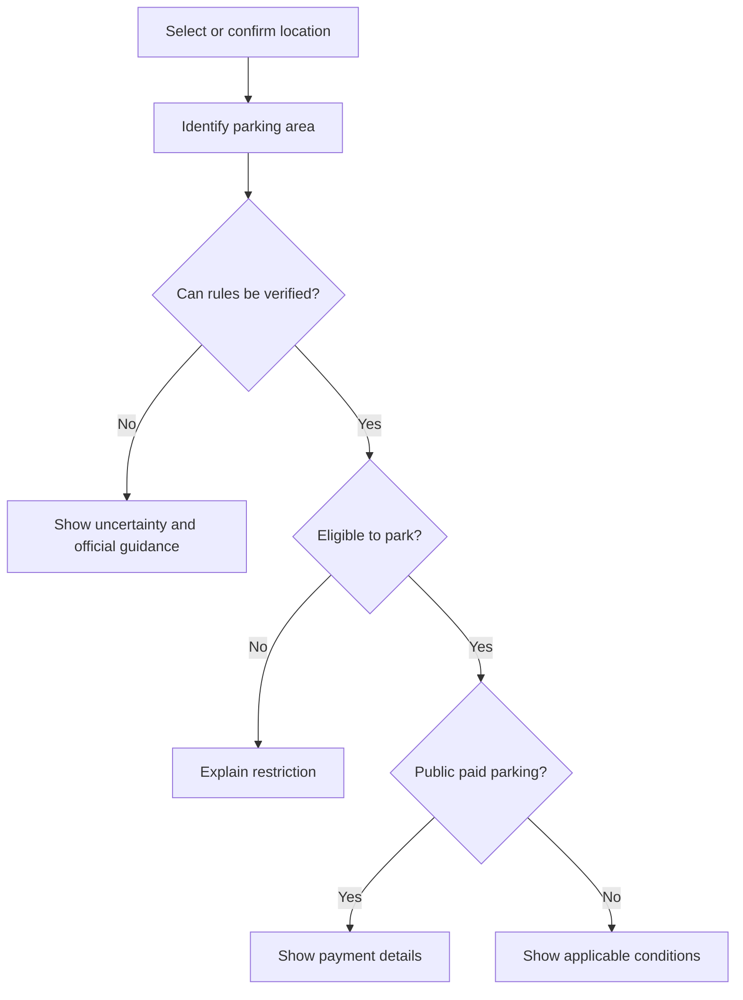

<!--@slide Opening-->
# Park Zone
## Can drivers understand parking rules before leaving the car?

Drivers in unfamiliar areas need a clear answer about whether they can park, what restrictions apply, and whether payment is required.

---

<!--@slide The problem-->
# Parking information is spread across sources

- Street signs may be unfamiliar or unclear.
- Prices, hours, and restrictions may be found in different places.
- Visitors may have difficulty understanding local rules.

---

<!--@slide Initial research-->
# Two interviews revealed difficulty finding payment information

- Both interviewees described difficulty locating parking payment information.
- One also described a language barrier when understanding rules and prices.
- These findings are preliminary and come from two interviews.

---

<!--@slide Competitor review-->
# The parking journey needs clearer information

- Explain areas where map coverage is unknown.
- Pair zone colours with readable labels.
- Clarify payment eligibility and empty states.
- Make external map hand-offs easier to understand.

---

<!--@slide Problem definition-->
# The key question is: can I park here?

The design focuses on drivers in unfamiliar areas who need to understand the parking-area type, eligibility, restrictions, and next action.

---

<!--@slide Information architecture-->
# Show eligibility before payment

---

<!--@slide Prototype-->
# The prototype connects the parking decision

- Select or confirm a location.
- Review the area result and conditions.
- Open place information or payment details.
- Show an unavailable-location state when the area cannot be verified.

[Open the Figma prototype](https://www.figma.com/design/k0XyRCchu76iPOL6gXmCNu/Prototype-Park-Zone?node-id=0-1)

---

<!--@slide Testing-->
# Three participants reviewed the prototype

- Feedback was generally positive.
- Some steps were described as complex.
- Trust and official information were important concerns.
- Formal task times and per-person success rates were not recorded.

---

<!--@slide Next iteration-->
# Improve clarity and validate the information

- Make status and next actions easier to scan.
- Show source and verification information when available.
- Test eligibility and uncertain-area scenarios with more drivers.
- Measure task completion and time in the next round.

---

<!--@slide Takeaway-->
# Unknown information must not look like permission

ZonePark puts eligibility and restrictions before payment, so drivers can make a more informed parking decision.
